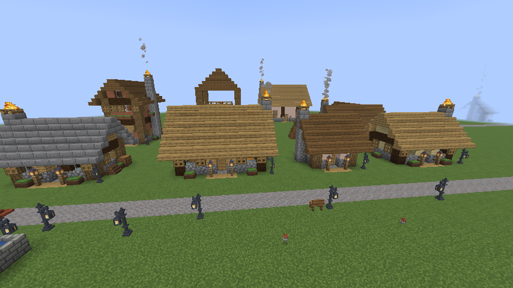
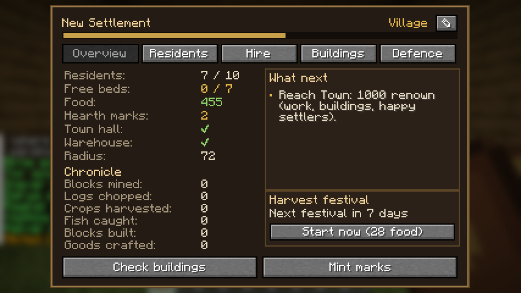
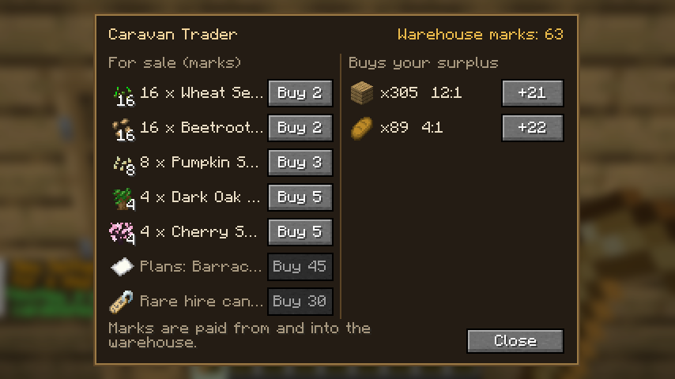
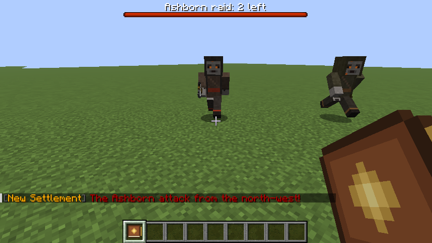
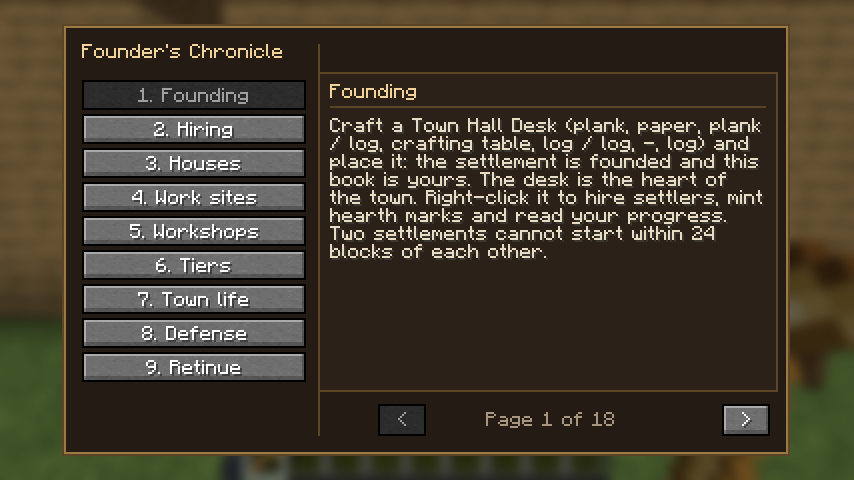
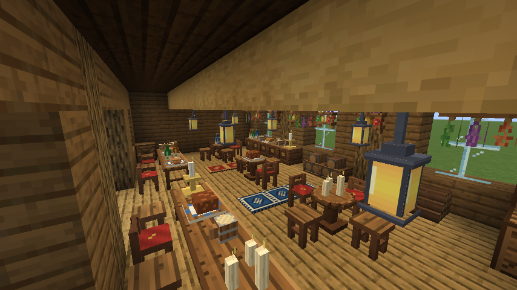
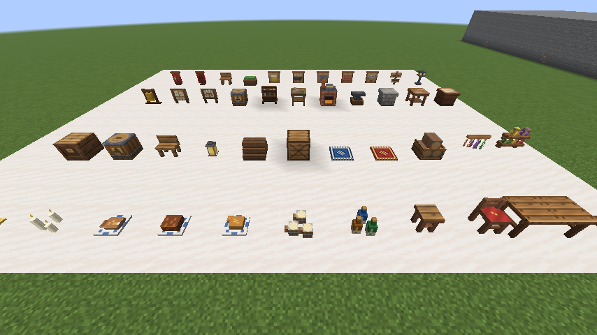
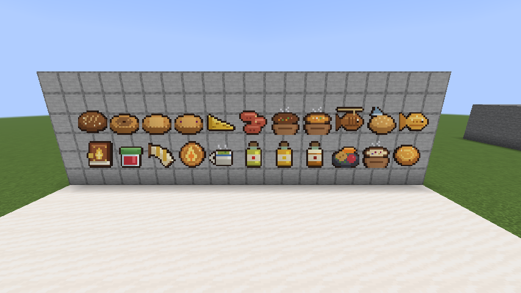

# Hearthholm — своё поселение с живыми жителями

Minecraft Java **26.3**, Fabric. Дизайн и архитектура: [DESIGN.md](DESIGN.md). Подсказки есть и в самой игре: при основании поселения вы получаете книгу **«Летопись основателя»** (ПКМ, 9 глав, RU и EN).

## Содержание

1. [Установка](#установка)
2. [Как играть (коротко)](#как-играть-коротко)
3. [Управление](#управление)
4. [Возможности по волнам](#возможности-по-волнам)
5. [Скриншоты](#скриншоты)
6. [Мастерские и экономика](#мастерские-и-экономика) · [Голоса очага](#голоса-очага-волна-b) · [Тени у ворот](#тени-у-ворот-волна-c) · [Дружина](#дружина-волна-d) · [Площадь и рынок](#площадь-и-рынок-волна-e) · [Полировка](#полировка-волна-f)
7. [Известные ограничения](#известные-ограничения)
8. [Разработка](#разработка)

## Установка

1. Скачайте архив `minecraft/dist/hearthholm-<версия>-mc26.3.zip` и распакуйте его.
2. Поставьте Fabric: <https://fabricmc.net/use/installer/> → Client → Minecraft 26.3 → Install.
3. Скопируйте оба .jar из папки `mods` архива в `%appdata%\.minecraft\mods`.
4. В официальном лаунчере выберите `fabric-loader-26.3` и нажмите «Играть».

## Как играть (коротко)

| Шаг | Что сделать |
|---|---|
| 0 | Книга **«Летопись основателя»** приходит в инвентарь при основании; потерянную можно скрафтить (книга + очаговая марка) |
| 1 | Скрафтите **Стол ратуши**: `доска бумага доска / бревно верстак бревно / бревно _ бревно` и поставьте его — так основано поселение |
| 2 | **Дом**: закрытая комната с крышей, **дверью** и **кроватью**. Можно прямо в ратуше |
| 3 | ПКМ по столу → **Найм**: выберите одного из трёх кандидатов. Цена — еда со склада или из вашего инвентаря |
| 4 | **Склад**: Книга склада (сундук + бумага + палка) в закрытой комнате с сундуками |
| 5 | ПКМ по жителю → выберите **профессию** |
| 6 | Поставьте **метку** работы (2 палки + предмет): шахта (булыжник), лес (саженец), поле (семена), рыбалка (нить), пост стражи (железо), знамя территории (шерсть), колышек стройки (бумага) |
| 7 | ПКМ по метке → настройки. Держите в руке любой предмет мода, и будет виден контур зоны |

## Управление

| Действие | Что делает |
|---|---|
| ПКМ по **Столу ратуши** | Обзор, жители, найм, постройки, оборона, праздник, чеканка марок |
| ПКМ по **жителю** | Профессия, нужды, черты, отношения, мысли; кнопка рыцаря с 5 уровня |
| **Shift+ПКМ** по жителю с предметом | Отдать инструмент, броню или еду |
| ПКМ по **метке** / колышку | Настройки зоны, чертёж, «Начать стройку» |
| ПКМ по **Доске заказов** / **Доске объявлений** | Постоянные заказы мастерским / задания жителей |
| ПКМ по **торговцу** или рыночной лавке | Экран торговли с караваном |
| ПКМ **Горном дружины** | Позвать до 4 бойцов; повторно: отпустить |
| ПКМ по **Колоколу тревоги** | Тревога / отбой |
| ПКМ **Летописью основателя** | Читать руководство (список глав слева, стрелки листают) |
| Любой предмет мода в руке | Подсвечиваются зоны меток |
| Файлы настроек | `config/hearthholm-threats.json`, `config/hearthholm-mint.json` |

## Возможности по волнам

| Волна | Что добавлено |
|---|---|
| **База** | Ратуша, найм за еду, дома и склад по комнатам, статы и черты, стройка по чертежам, шахтёр, лесоруб, фермер, рыбак, стража, воины, метки-зоны, RU/EN |
| **A Мастерские** | Плотник, каменщик, кузнец, повар, носильщик, доска заказов, очаговые марки |
| **B Голоса очага** | Реплики-пузыри, отношения, мысли и настроение, праздник урожая, легендарные кандидаты, звуки |
| **C Тени у ворот** | Налёты Пепельников, ночь Разлома, Вождь Пепла, колокол тревоги, частокол и ворота, вкладка «Оборона» |
| **D Дружина** | Горн, отряд до 4, лучник, знахарь, рыцари, казарма, масштабирование боя, отступление |
| **E Площадь и рынок** | Уровни открывают постройки, таверна и трактирщик, караван торговца, декор-блоки, доска объявлений, топливо |
| **F Полировка** | Летопись основателя, баланс в одном месте, частицы и звуки работы и событий, декор в заказах мастерских, башня с уровня «посёлок», страницы каталога, правка экрана торговли |

## Скриншоты

Сделаны автотестом (программный рендер, 854x480).

| | |
|---|---|
|  Поселение сверху |  Ратуша, вкладка «Обзор» |
|  Мастерская плотника |  Таверна с бочонком и гостями |
|  Караван: экран торговли |  Налёт Пепельников |
|  Вкладка «Оборона» |  Дружина идёт за игроком |
|  Летопись основателя |  Глава «Уровни» |
|  Колодец 3x3 |  Таверна: столы, стулья, бутылки, фонари |
|  Новая мебель и посуда |  Блюда и предметы |

## Мастерские и экономика

| Что | Как |
|---|---|
| **Мастерская** | Поставьте в закрытую комнату с дверью рабочее место: **верстак плотника** (верстак + бревно + палка), **стол каменщика** (верстак + 2 булыжника + камень), **наковальню кузнеца** (`ЖЖЖ / _Б_ / БББ`, Ж — железо, Б — булыжник) или **кухонную плиту** (печь + миска + булыжник). Комната станет мастерской (видно во вкладке «Постройки») |
| **Ремесленники** | Плотник, каменщик, кузнец, повар работают в своей мастерской: берут сырьё со склада, делают вещи по ванильным рецептам и несут их на склад. Каменщику и кузнецу для плавки нужна печь в той же комнате; повару хватает плиты. Кузнец ещё и чинит изношенные инструменты жителей |
| **Доска заказов** | (2 доски + 2 бумаги + палка) ПКМ → выберите мастерскую, вещь и количество: «держать 64 доски». Рядом с каждым заказом видно, что мешает: «нужно 3× пшеница», «нет мастерской», «нет печи». Без заказов кухни повар держит на складе 32 блюда |
| **Носильщик** | Относит добычу из сундуков у меток на склад и держит в сундуке у колышка стройки стопку нужного материала |
| **Вкусный обед** | Хлеб, жареное мясо, похлёбки, пироги дают настроение «Вкусный обед +8» на сутки; жители берут готовую еду в первую очередь |
| **Очаговые марки** | Ратуша → «Обзор» → «Чеканить марки»: излишки склада превращаются в марки (по умолчанию 16 железа/золота/изумрудов или 64 урожая за марку, часть остаётся в запасе). Курс — в `config/hearthholm-mint.json`. Марки платят за торговлю с караваном, повышение в рыцари и награды |

- **Shift+ПКМ** по жителю с предметом в руке: отдать инструмент, броню или еду.
- Рядом с меткой шахты/поля поставьте сундук, туда пойдёт добыча.
- В ратуше вкладка «Обзор» подсказывает следующий шаг, а «Постройки» показывает, почему комната не засчитана.

## Голоса очага (волна B)

| Что | Как |
|---|---|
| **Реплики** | Жители изредка говорят короткую фразу над головой (≈4 с, у каждого своя пауза 30–90 с, рядом видно не больше 3): приветствуют хозяина, жалуются на голод и отсутствие кровати, комментируют работу, ночь, дождь, повышение уровня, вкусный обед, праздник; у характера свои фразы. Около 180 фраз на русском и английском, звук — тихое бормотание |
| **Отношения** | Жители, которые рядом отдыхают или едят, понемногу сближаются; ворчуны иногда ссорятся (−8). Дружба (симпатия > 40) → вечером друзья сами находят друг друга и болтают (реплики, ноты, сердечки). Лучший друг и соперник видны на экране жителя |
| **Мысли** | Таймерные пункты настроения: «Видел праздник +12» (3 дня), «Есть друг +5», «Поссорился −6», «Красивый дом +6» (уют ≥ 8), «Вкусный обед +8», «Гордится успехами +6», «Промок под дождём −3». Хранятся в сохранении жителя |
| **Праздник урожая** | Раз в 7 игровых дней в полдень, если на складе еды ≥ 4 × жителей: все собираются на площади у ратуши на ≈2 игровых часа, пляшут, играет праздничная мелодия, колокол. Еда тратится. Ратуша → «Обзор» показывает «Следующий праздник через N дн.» и кнопку «Начать сейчас» (за еду) |
| **Легендарные** | ≈8% кандидатов: золотая звезда, 2 черты, +2 к двум способностям и уникальное прозвище («Каменолом», «Орлиный Глаз»…) |
| **Звуки** | Колокол ратуши (основание, найм, праздник), бормотание, праздничная мелодия — сгенерированы `tools/gen_sounds.py` |

## Тени у ворот (волна C)

| Что | Как |
|---|---|
| **Пепельники** | Враждебная фракция: **налётчик** (факел или топор), **поджигатель** (бежит к деревянным домам и поджигает их), **лучник**, **громила** (много здоровья, щит — стрелы почти не берут, отбрасывает, ломает частокол, ворота и двери). Нападают на жителей и игрока; стража и воины бьют их в ответ |
| **Налёты** | Начинаются с уровня «хутор» после 3 дней передышки, потом каждые 5–8 дней в сумерках. Сила растёт с богатством: слава + содержимое склада + число жителей. За 60 секунд — горн, сообщение «с какой стороны», полоса-таймер сверху, колокол тревоги. 2–3 волны выходят с края поселения и идут к ратуше. Все убиты → победа: слава, очаговые марки на склад, мысль «Мы выстояли +10». Через 5 минут уцелевшие уходят → «Потери от налёта −10» |
| **Ночь Разлома** | Раз в ~10 дней ночью у границы появляется **Разлом**: светящееся ядро между столбами плачущего обсидиана, гудит и выпускает зомби, скелетов, пауков и **огоньков Разлома** (быстрые летающие искры). Разрушьте ядро (кирка) — или его разобьют воины. Награда: **осколки Разлома** и +30 славы |
| **Фонарь Разлома** | 4 осколка + фонарь (`_О_ / ОФО / _О_`): в радиусе 24 блоков монстры не появляются сами |
| **Вождь Пепла** | Босс налётов с уровня «городок» (или яйцо призыва). Шкала здоровья, 3 фазы: гнев → ярость (быстрее бьёт и бегает) → пепельная буря (зовёт налётчиков, огненные круги: сначала мерцающее кольцо-предупреждение, через 2 с — огонь). Добыча: гора марок и **Знамя Вождя** — поставьте его в ратуше, и у всех жителей будет мысль «Трофей победы +5» |
| **Колокол тревоги** | 7 палок + золото (`ППП / ПЗП / П_П`). ПКМ — тревога: мирные бегут к своим кроватям или в ратушу и сидят там, стража и воины идут к колоколу. ПКМ ещё раз — отбой. При налёте звонит сам |
| **Частокол** | 4 бревна + 2 палки → 6 (`БПБ / БПБ`). Не горит, держит взрывы, через него нельзя перепрыгнуть. **Ворота частокола** (5 частоколов + железо): открываются как дверь для жителей и игрока, налётчики их не открывают, при тревоге закрываются |
| **Чертежи** | «Сторожевая башня» (с лестницей, площадкой и колоколом) и «Частокол с воротами» для колышка стройки |
| **Ратуша → «Оборона»** | Когда следующий налёт (скоро/не скоро), ожидаемая сила, итог прошлого налёта, счёт побед, Разломы, кнопка тревоги |

Настройки — `config/hearthholm-threats.json`: `raids`, `raidFire` (поджоги, по умолчанию да; огонь гаснет через ~8 с вместе с тем, что успело разгореться рядом), `rifts`, интервалы. **Свисток основателя** (только творческий режим): Shift+ПКМ — выбор режима, ПКМ — налёт / Разлом / Вождь / отбой.

## Дружина (волна D)

| Что | Как |
|---|---|
| **Горн дружины** | Железо + золото + кожа (`ИИ_ / ИЗИ / _ИК`). ПКМ: до 4 ближайших ваших бойцов (стражник, воин, лучник, рыцарь; в радиусе 48) вступают в отряд. Они ходят за вами по миру, **телепортируются**, если отстали больше чем на 24 блока или вы ушли в другое измерение, бьют тех, кто нападает на вас, и тех, кого бьёте вы, едят из своих карманов (или из вашей левой руки), пока в отряде не занимаются работой. Ещё раз ПКМ (или Shift+ПКМ) — все идут домой. Состояние отряда хранится в самом жителе и переживает перезаход |
| **Лучник** | Профессия: лук и стрелы со склада (стрелы расходуются, при <12 сам идёт за новыми). Держит дистанцию 7–14 блоков, ходит по постам стражи. Лук — в инструментах |
| **Знахарь** | Профессия, мастерская «Знахарская» (**Стол знахаря**: стол + ягоды + бутылка). Идёт к раненым жителям (здоровье < 70 %) и лечит их, пока не поправятся (сердечки). Если раненых нет, варит на столе **Целебную мазь** (1 бутылка + 2 травы со склада: ягоды, ласта, цветы, папоротник; запас на складе 8). Мазью пользуется раненый (ниже 50 %), рядом с которым нет знахаря; игрок может выпить её сам (+8) |
| **Рыцарь** | Стражник или воин **5 уровня**: в экране жителя кнопка «Повысить до рыцаря» (10 очаговых марок + комплект железной брони со склада). Больше здоровья и брони, **щит** (удары спереди ослаблены), **таунт**: раз в ~8 с тянет на себя налётчиков, которые бьют других. Кнопка выбора профессии для рыцаря не показывается |
| **Казарма** | Комната с дверью и **Оружейной стойкой** (3 доски + палки + железо). Раненый боец (< 85 %) идёт отдыхать туда: лечение в 5 раз быстрее обычного, мысль «Боевые товарищи +4». Чертёж «Казарма» для колышка стройки |
| **Баланс обороны** | Здоровье, урон и естественная броня бойцов растут с уровнем (стражник 1-го уровня ≈ 35 здоровья), бойцы получают опыт за удары и выстрелы. Ниже 30 % здоровья боец **отступает** в казарму (или к знахарю) и возвращается при 70 %. Жители медленно лечатся сами (кроме боя). Налётчик, до чьей цели нельзя добраться (дом заперт), бросает её на полминуты: ищет другую цель, идёт ломать ближайшую дверь (двери ломают все пепельники, частокол и ворота — громилы и вождь, надёжнее и вместе со всей колонной) |

## Площадь и рынок (волна E)

| Что | Как |
|---|---|
| **Уровни открывают постройки** | Хутор — мастерская и фермерский дом, посёлок — таверна и рыночная лавка, городок — казарма и участок каменной стены. В экране колышка стройки закрытый чертёж выделен серым и подписан «Закрыто: нужен уровень …»; сервер такой чертёж не принимает, а строитель его не строит. Подсказка в ратуше говорит, что откроет следующий уровень. Торговец иногда продаёт чертёж раньше срока |
| **Таверна** | Комната с дверью и **Бочонком таверны** (бочка + миска) или чертёж «Таверна». Профессия **Трактирщик**. Вечером (после работы, до сна) свободные жители идут в таверну: мысль «Вечер в таверне +8»; трактирщик подаёт ужин со склада (4 очка еды) — мысль «Горячий ужин +6» и сытость. Стражи на ночной смене не приходят |
| **Караван торговца** | Раз в 7 игровых дней (с уровня «хутор», утром) приходит торговец с ламой на рынок (рыночная лавка, иначе площадь) и остаётся на сутки. ПКМ по торговцу или по лавке: **покупает излишки** склада за очаговые марки (камень, дрова, уголь, зерно… запас остаётся) и **продаёт**: семена, саженцы редких деревьев, чертёж более высокого уровня, редкого кандидата в жители. Марки берутся со склада и идут на склад |
| **Декор** | Фонарный столб, указатель, скамья, колодец, прилавок, цветочный ящик, вывески (плотник, каменщик, кузнец, повар, таверна), **знамя поселения** (ПКМ красителем — цвет полотна, пустой рукой — цвет эмблемы). Три и более декор-блока в радиусе 8 блоков от жителя дают на сутки мысль «Красивая улица +6» |
| **Доска объявлений** | Блок (доски + бумага + палка). До трёх заказов, обновляются раз в день: «принесите N предметов» (сдайте из рюкзака) или «прогоните N пауков/зомби/скелетов рядом с меткой» (считаются любые убийства рядом). Награда: очаговые марки на склад, слава или подарок игроку |
| **Починки** | Плавка и готовка (печка, дымовая печь…) **расходуют топливо** со склада (уголь, дрова, доски; 1 уголь = 8 партий), без топлива заказ помечен «нужно топливо». Поджигатели больше не жгут крыши: целью служат только частокол, ворота, двери и заборы, а огонь не ставят под навесом; метки огня сохраняются в поселении и гасятся даже после перезапуска |

## Полировка (волна F)

| Что | Как |
|---|---|
| **Летопись основателя** | Книга-руководство: 9 глав (основание, найм, дома, метки, мастерские, уровни, жизнь города, оборона, дружина). Выдаётся один раз при основании (флаг в сохранении), крафт: книга + очаговая марка |
| **Баланс** | Все числа (найм, пороги уровней, налёты, цены каравана, награды заказов, настроение) в `core/Balance.java`; изменения и причины в DESIGN, раздел 7. Сила налёта ограничена уровнем поселения |
| **Эффекты** | Щепки и стук при рубке, пыль и звон кирки, искры кузни, дым кухни, фанфара при повышении уровня жителя или поселения, ноты на празднике, рог и пыль при приходе каравана, звон выполненного заказа. Звуки синтезированы процедурно, субтитры есть |
| **Декор в заказах** | Плотнику можно заказать бочонок, скамью, прилавок, цветочный ящик, указатель и вывески; кузнецу фонарный столб; каменщику колодец. Каталог листается страницами по 14 вещей |
| **Башня** | Чертёж сторожевой башни доступен с уровня «посёлок» (купленный у торговца открывает раньше; уже построенные башни не затронуты) |

## Волна G: пробелы и скриншоты

| Что | Как |
|---|---|
| **Летопись в старых сохранениях** | Если у поселения флаг `guide_given` ложный, хозяин получает книгу один раз при первом открытии стола ратуши |
| **Конфиг баланса** | `config/hearthholm.json` (Gson): все числа из `core/Balance.java` по именам полей; файл с умолчаниями создаётся при первом запуске, лишние/кривые ключи игнорируются |
| **Отряд и чанки** | Положение бойцов хранится в сохранении; ушёл далеко/сменил измерение/горн с отставшими: бойцы подгружаются и телепортируются к вам, горн «созывает» отставших вместо роспуска |

## Волна H1: уют (блоки, мебель, еда)

| Что | Как |
|---|---|
| **Перерисовка** | Все старые блоки и предметы получили объём (брусья, обручи, ручки, заклёпки), зерно дерева, блики металла и обводку; модели стола ратуши, бочонка, фонаря, скамьи, прилавка и др. переработаны |
| **Колодец 3x3** | Предмет «Колодец» ставит сразу 21 блок: каменное кольцо, воду, два столба, крышу с воротом, верёвку и ведро. Нет места (нужна площадка 3x3 и высота 3) - не ставится, сообщение над панелью. Сломать любую часть - исчезает весь колодец и падает один предмет. Центр сохранил старый id `hearthholm:well`, старые одиночные колодцы работают, «Красивая улица» считает его как раньше |
| **Мебель** | Круглый и длинный стол (длинные столы стыкуются без ножек между ними), стул и табурет (ПКМ - сесть, Shift - встать; сидение - невидимая сущность, исчезает вместе с блоком), настенная полка с банками, подвесные травы, стеллаж с бочками, коврики, ящик, поленница, подвесной фонарь |
| **На столах** | Бутылки, кружки, свечи (1-3 в блоке, ставятся друг на друга как свечи), тарелки с хлебом/жарким/рыбой, подсвечник. На столе (высота 14/16) модель опускается на 2 пикселя, чтобы стоять на столешнице |
| **18 блюд** | Жареная и копчёная рыба, рыбный и мясной пироги, уха, рагу, колбаса, сыр, ягодный и яблочный пироги, ржаной каравай, медовая булочка, каша, печёные овощи, эль, медовуха, сидр (небольшой бафф), травяной чай. Рецепты ванильные (верстак, коптильня/печь для копчёной рыбы) |
| **Каталоги** | Блюда в заказах повара и в продаже каравана; мебель и посуда в каталогах плотника, каменщика и кузнеца (только данные) |

## Волна H2: уют (дома и люди)

| Что | Как |
|---|---|
| **Дома не коробки** | Чертежи `small_house`, `farmhouse`, `workshop`, `tavern`, `market_stall`, `barracks`, `watchtower` переделаны: двускатные крыши из ступеней и плит со свесом в 1 блок, труба с костром-дымником, цоколь из булыжника, угловые столбы из брёвен, смешанные стены (штукатурка из белой терракоты, доски, камень, каркас из брёвен), окна со ставнями-люками и ящиками с цветами под ними, крыльцо с фонарями, лампа у дороги. Id и порядок в `index.json` прежние |
| **Обстановка** | Внутри мебель H1: столы, стулья, табуреты, коврики, полки, свечи, бочки, ящики, сундуки, кровати, подвесные фонари. Таверна: большой зал, стойка с бочонком, длинные столы, балки с фонарями и галерея на втором ярусе с лестницей; навес рынка из красной и белой шерсти |
| **4 новых дома** | `cottage` (коттедж), `townhouse` (двухэтажный городской дом), `fisher_hut` (хижина рыбака со стойкой для сушки), `l_house` (Г-образный дом с двумя крышами). Доступны с начала, добавлены в конец списка |
| **Материалы** | Каждый блок можно достать: каталог плотника (ступени и плиты дуба и ели, шерсть, костёр, кровати), каменщика (терракота, стеклянные панели), кузнеца (фонари); брёвна, булыжник, гравий - добыча |
| **Скины поселенцев** | 20 новых заготовок (10 женщин и 10 мужчин, по два старика): новые причёски (длинные, две косы, пучок, каре, хвост; мужские длинные, залысины, кудри), платья, юбки, сарафаны с передником, жилеты, туники, длинные робы, платки, кепки, шерстяные шапки, морщины у стариков. Пол внешности совпадает с именем (женские имена EN+RU уже были). Старые сохранения выглядят как раньше |
| **Мелочи** | Стол ратуши, бочонок и фонарь-столб собраны из нескольких деталей без зазоров; колодец: столбы стоят на кольце, верёвка до ведра без щелей; подвесной фонарь собран из каркаса |

## Известные ограничения

- Баланс настроен по расчёту и по автотесту, а не по длинной живой игре: цифры в `Balance.java` стоит подкрутить после партий.
- Отряд: бойцы в незагруженных чанках подгружаются (чанк временно «форсится») и приводятся к лидеру не чаще раза в ~5 с, не более 3 за раз; бойцы пропавшие без вести (убитые) удаляются из списка после трёх неудач. Переход Нижний мир/Верхний мир проверен автотестом, Энд не проверялся.
- Потери при налёте недетерминированы (0-2 жителя в тесте); огонь налёта держится ~8 с, горят только частокол, ворота, двери и заборы.
- Найм легендарных кандидатов, работа каменщика и кузнеца проверены автотестом поверхностно.
- Декор из каталога заказов мастера делают, только если нужные ингредиенты лежат на складе.
- Звуки короткие и синтетические, частицы ванильные: свой набор частиц не добавлялся.
- Скриншоты сделаны программным рендером без теней и шейдеров.

## Разработка

```bash
bash ../../tools/setup-jdk.sh                       # JDK 25
export JAVA_HOME=/opt/jdk-25 PATH=/opt/jdk-25/bin:$PATH
./gradlew build                                     # build/libs/hearthholm-*.jar
bash ../../tools/run-client-test.sh .               # автотест со скриншотами (build/run/clientGameTest/screenshots), HH_ONLY_F=1 — только волна F
bash ../../tools/package-mod.sh .                   # архив для лаунчера в minecraft/dist/
python3 tools/gen_textures.py && python3 tools/gen_assets.py && python3 tools/gen_lang.py && python3 tools/gen_sounds.py   # ресурсы
```
