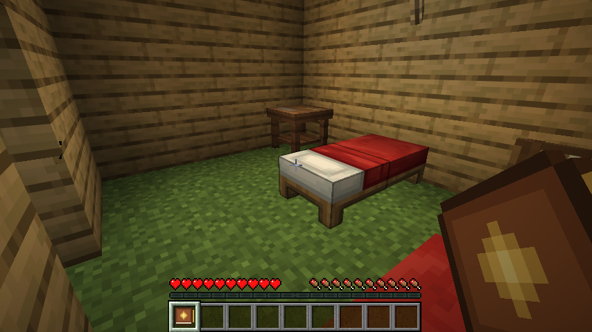
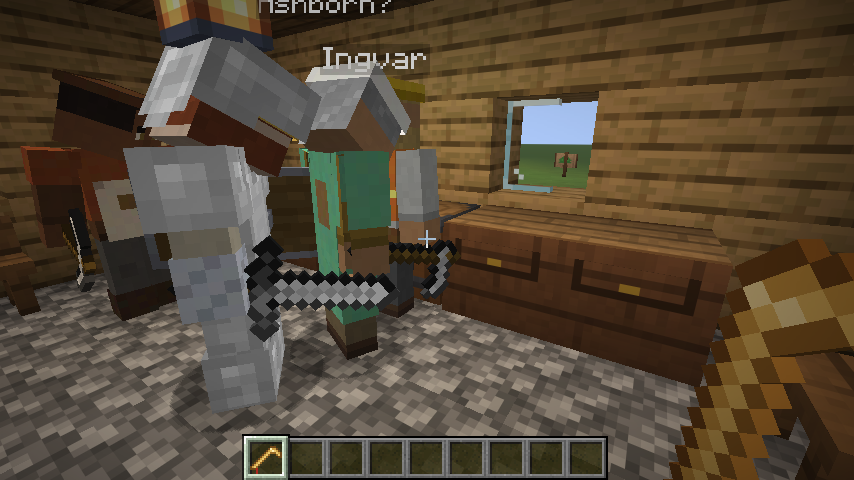
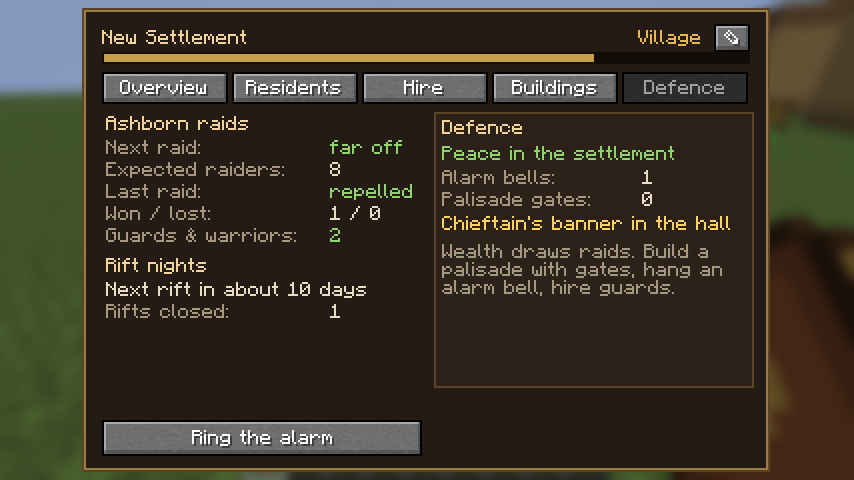
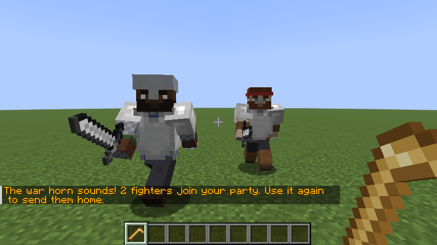
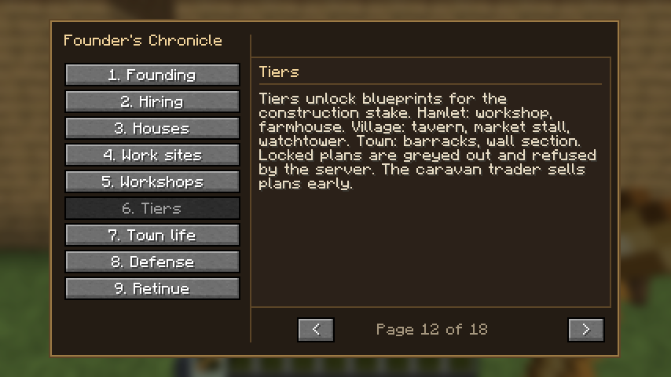
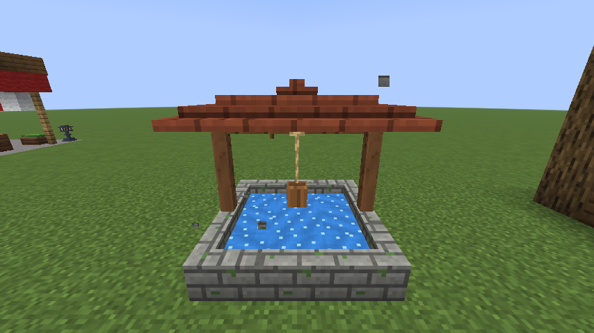

# Hearthholm — своё поселение с живыми жителями

Minecraft Java **26.3**, Fabric. Дизайн и архитектура: [DESIGN.md](DESIGN.md). Подсказки есть и в самой игре: при основании поселения вы получаете книгу **«Летопись основателя»** (ПКМ, 9 глав, RU и EN).

## Содержание

1. [Установка](#установка)
2. [Как играть (коротко)](#как-играть-коротко)
3. [Управление](#управление)
4. [Возможности по волнам](#возможности-по-волнам)
5. [Скриншоты](#скриншоты)
6. [Подробно по волнам](#подробно-по-волнам) (A–L3, файлы в `docs/waves/`)
7. [Известные ограничения](#известные-ограничения)
8. [Разработка](#разработка)

## Установка

1. Скачайте архив `minecraft/dist/hearthholm-<версия>-mc26.3.zip` и распакуйте его.
2. Поставьте Fabric: <https://fabricmc.net/use/installer/> → Client → Minecraft 26.3 → Install.
3. Скопируйте оба .jar из папки `mods` архива в `%appdata%\.minecraft\mods`.
4. В официальном лаунчере выберите `fabric-loader-26.3` и нажмите «Играть».

## Как играть (коротко)

| Шаг | Что сделать |
|---|---|
| 0 | Книга **«Летопись основателя»** приходит в инвентарь при основании; потерянную можно скрафтить (книга + очаговая марка) |
| 1 | Скрафтите **Стол ратуши**: `доска бумага доска / бревно верстак бревно / бревно _ бревно` и поставьте его — так основано поселение |
| 2 | **Дом**: закрытая комната с крышей, **дверью** и **кроватью**. Можно прямо в ратуше |
| 3 | ПКМ по столу → **Найм**: выберите одного из трёх кандидатов. Цена — еда со склада или из вашего инвентаря |
| 4 | **Склад**: Книга склада (сундук + бумага + палка) в закрытой комнате с сундуками |
| 5 | ПКМ по жителю → выберите **профессию** |
| 6 | Поставьте **метку** работы (2 палки + предмет): шахта (булыжник), лес (саженец), поле (семена), рыбалка (нить), пост стражи (железо), знамя территории (шерсть), колышек стройки (бумага) |
| 7 | ПКМ по метке → настройки. Держите в руке любой предмет мода, и будет виден контур зоны |

## Управление

| Действие | Что делает |
|---|---|
| ПКМ по **Столу ратуши** | Обзор, жители, найм, постройки, оборона, праздник, чеканка марок |
| ПКМ по **жителю** | Профессия, нужды, черты, отношения, мысли; кнопка рыцаря с 5 уровня |
| **Shift+ПКМ** по жителю с предметом | Отдать инструмент, броню или еду |
| ПКМ по **метке** / колышку | Настройки зоны, чертёж, «Начать стройку» |
| ПКМ по **Доске заказов** / **Доске объявлений** | Постоянные заказы мастерским / задания жителей |
| ПКМ по **торговцу** или рыночной лавке | Экран торговли с караваном |
| ПКМ **Горном дружины** | Позвать до 4 бойцов; повторно: отпустить |
| ПКМ по **Колоколу тревоги** | Тревога / отбой |
| ПКМ **Летописью основателя** | Читать руководство (список глав слева, стрелки листают) |
| Любой предмет мода в руке | Подсвечиваются зоны меток |
| Файлы настроек | `config/hearthholm-threats.json`, `config/hearthholm-mint.json` |

## Возможности по волнам

| Волна | Что добавлено |
|---|---|
| **База** | Ратуша, найм за еду, дома и склад по комнатам, статы и черты, стройка по чертежам, шахтёр, лесоруб, фермер, рыбак, стража, воины, метки-зоны, RU/EN |
| **A Мастерские** | Плотник, каменщик, кузнец, повар, носильщик, доска заказов, очаговые марки |
| **B Голоса очага** | Реплики-пузыри, отношения, мысли и настроение, праздник урожая, легендарные кандидаты, звуки |
| **C Тени у ворот** | Налёты Пепельников, ночь Разлома, Вождь Пепла, колокол тревоги, частокол и ворота, вкладка «Оборона» |
| **D Дружина** | Горн, отряд до 4, лучник, знахарь, рыцари, казарма, масштабирование боя, отступление |
| **E Площадь и рынок** | Уровни открывают постройки, таверна и трактирщик, караван торговца, декор-блоки, доска объявлений, топливо |
| **F Полировка** | Летопись основателя, баланс в одном месте, частицы и звуки работы и событий, декор в заказах мастерских, башня с уровня «посёлок», страницы каталога, правка экрана торговли |

## Скриншоты

Сделаны автотестом (программный рендер, 854x480).

| | |
|---|---|
|  Поселение сверху |  Ратуша, вкладка «Обзор» |
|  Мастерская плотника |  Таверна с бочонком и гостями |
|  Караван: экран торговли |  Налёт Пепельников |
|  Вкладка «Оборона» |  Дружина идёт за игроком |
|  Летопись основателя |  Глава «Уровни» |
|  Колодец 3x3 с настоящей водой |  Таверна: столы, стулья, бутылки, фонари |
|  Новая мебель и посуда |  Блюда и предметы |

## Подробно по волнам

- [Мастерские и экономика](docs/waves/A.md)
- [Голоса очага (волна B)](docs/waves/B.md)
- [Тени у ворот (волна C)](docs/waves/C.md)
- [Дружина (волна D)](docs/waves/D.md)
- [Площадь и рынок (волна E)](docs/waves/E.md)
- [Полировка (волна F)](docs/waves/F.md)
- [Волна G: пробелы и скриншоты](docs/waves/G.md)
- [Волна H1: уют (блоки, мебель, еда)](docs/waves/H1.md)
- [Волна H2: уют (дома и люди)](docs/waves/H2.md)
- [Волна H3: полировка внешнего вида](docs/waves/H3.md)
- [Волна I1: играбельность работников](docs/waves/I1.md)
- [Волна I2: играбельность (стража и лучники)](docs/waves/I2.md)
- [Волна J1: инвентарь жителя](docs/waves/J1.md)
- [Волна J2: карта зоны и колода дровосека](docs/waves/J2.md)
- [Волна J3: камень шахтёра и 3D-план раскопок](docs/waves/J3.md)
- [Волна K1: стройка, рецепты, совладельцы](docs/waves/K1.md)
- [Волна K2: рабочий день, сдача вещей, темп шахтёра](docs/waves/K2.md)
- [Волна L0: дровосек у листвы, медленнее уровни](docs/waves/L0.md)
- [Волна M1: баги и мелочи (названия чертежей, владельцы и стража, еда, припасы шахтёра, кирки строителя)](docs/waves/M1.md)
- [Волна M2: галочки на колышке, заказ недостающего, направления тоннеля шахтёра](docs/waves/M2.md)
- [Волна L1: боевые роли (страж/воин/лучник), щиты, стрейф, арбалетчик, кавалерист](docs/waves/L1.md)
- [Волна L2: зоны фермера 30x30, рыбака 10x10, воина 50x50, новые метки](docs/waves/L2.md)
- [Волна L3: свои частицы, призрачный чертёж здания](docs/waves/L3.md)

## Известные ограничения

- Баланс настроен по расчёту и по автотесту, а не по длинной живой игре: цифры в `Balance.java` стоит подкрутить после партий.
- Отряд: бойцы в незагруженных чанках подгружаются (чанк временно «форсится») и приводятся к лидеру не чаще раза в ~5 с, не более 3 за раз; бойцы пропавшие без вести (убитые) удаляются из списка после трёх неудач. Переход Нижний мир/Верхний мир проверен автотестом, Энд не проверялся.
- Потери при налёте недетерминированы (0-2 жителя в тесте); огонь налёта держится ~8 с, горят только частокол, ворота, двери и заборы.
- Найм легендарных кандидатов, работа каменщика и кузнеца проверены автотестом поверхностно.
- Декор из каталога заказов мастера делают, только если нужные ингредиенты лежат на складе.
- Звуки короткие и синтетические; частицы с волны L3 свои (искры, угольки, пыль, призрак чертежа), ванильные остались там, где подходят.
- Скриншоты сделаны программным рендером без теней и шейдеров.

## Разработка

```bash
bash ../../tools/setup-jdk.sh                       # JDK 25
export JAVA_HOME=/opt/jdk-25 PATH=/opt/jdk-25/bin:$PATH
./gradlew build                                     # build/libs/hearthholm-*.jar
bash ../../tools/run-client-test.sh .               # автотест со скриншотами (build/run/clientGameTest/screenshots), HH_ONLY_F=1 — только волна F, HH_ONLY_I2=1 — только волна I2
bash ../../tools/package-mod.sh .                   # архив для лаунчера в minecraft/dist/
python3 tools/gen_textures.py && python3 tools/gen_assets.py && python3 tools/gen_lang.py && python3 tools/gen_sounds.py   # ресурсы
```
